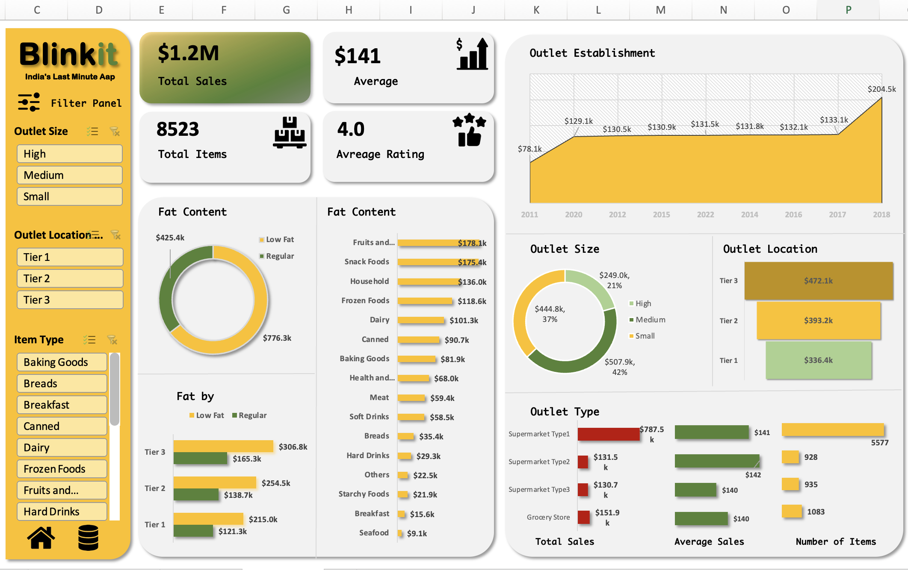

# Blinkit Sales Dashboard (Excel)

An interactive Excel dashboard built on Blinkit grocery data (8,523 items) to explore sales performance across outlet types, locations, sizes, item categories and fat content.

## Key Metrics
- Total Sales: $1.2M
- Average Sales: $141
- Total Items: 8,523
- Average Rating: 4.0

## What the Data Shows
- **Fat Content:** Regular items brought $776.3k, while Low Fat items brought $425.4k.
- **Top Item Types:** Fruits and Vegetables ($178.1k), Snack Foods ($175.4k), Household ($136.0k) and Frozen Foods ($118.6k). Seafood ($9.1k) is the lowest.
- **Outlet Size:** Medium 42% ($507.9k), Small 37% ($444.8k), High 21% ($249.0k).
- **Outlet Location:** Tier 3 ($472.1k), Tier 2 ($393.2k), Tier 1 ($336.4k).
- **Outlet Type:** Supermarket Type1 generated $787.5k from 5,577 items. Grocery Store: $151.9k, Type2: $131.5k, Type3: $130.7k.
- **Outlet Establishment:** Sales were $78.1k for outlets established in 2011 and $204.5k for outlets established in 2018.

## Features
- Pivot Tables and Pivot Charts (Doughnut, Bar, Area, Column)
- Interactive Slicers for Outlet Size, Outlet Location and Item Type
- KPI cards for Total Sales, Average Sales, Total Items and Average Rating
- Blinkit-themed dashboard layout

## Files
- `Blinkit_Grocery_byme.xlsx` : Excel workbook with data and dashboard
- `Blinkit_Dashboard.png` : Dashboard screenshot
- `Blinkit_Dashboard_video.mov` : Short walkthrough video

## Tools Used
Microsoft Excel (Pivot Tables, Pivot Charts, Slicers)

## Author
Sarthak Mohit Kumar | Aspiring MIS Executive & Data Analyst
